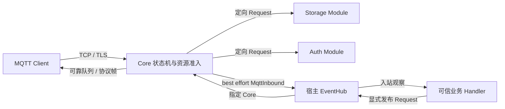

# 架构与边界

依赖固定为 Modorch 0.0.3 / git `336ba20196044e1b81fb2ca297a18b5e258a5800`，使用 Skill Bundle 1.0.7。已解析源码指纹为 `94c55b12e921954eabe9008354e347e31c9b0ec2d577689ca6a18c2234a947a9`，身份检查见[开始使用](getting-started.md)。

## 宿主与组件

宿主拥有 Application、EventHub、TaskScheduler 和退出策略。`MqttBrokerFactory` 保存跨组件代际的内存状态，每个 Application 使用新的 Factory。注册不实例化或监听；setup 最多绑定未监听 socket，所有相关组件 ready 后由 `activate_ingress` 完成恢复并 listen。

`modorch-mqtt-api` 提供 DTO；Core 持有协议及资源状态；Auth、SQLite Storage、Admin 和 Metrics 是可选 Module。Facade 的 Feature 与宿主的显式组件选择共同决定能力。Core 只通过类型化 EventHub Request 访问外部 Provider，不直接调用 SQLite。

## 数据与控制路径

Core 在短同步临界区内匹配 Session 订阅；当前为线性匹配，没有 Trie 或分片容量承诺。`+` 匹配一层含空层，末尾 `#` 包括零层；根通配不匹配 `$`，`:id` 为字面量。重叠订阅按最高匹配 QoS 去重。共同语义用[共享 JSON 向量](../contracts/topic-vectors.json)核对 Core、Facade、真实 Hub Handler 及网络路由。MQTT3.1.1 下 `$share` 仍为普通字面 Topic。

可靠发布先预留全部目标、Retained 和配额，再原子接纳。QoS0 出站是有界 best effort 队列；QoS1/2 进入可靠队列并保留 Packet ID 和握手阶段。双向 QoS2 及控制 FIFO 见 [qos2.md](qos2.md)。

## EventHub 与防回环

网络消息成功接纳后产生 `MqttInbound`，通过宿主 Hub 的 `external()` 发布原 Topic。观察失败计数，不改变 MQTT ACK，也不等待业务执行。Will 和内部发布不生成这类网络观察。

出站只接受直接寻址 Core、具有框架可信 Handler source 的类型化发布 Request；任意普通 Event 不会自动出网。请求带来源隔离的 request_id，成功或已记录的拒绝终态可查询。业务若主动把入站观察再次发布，必须自行定义来源/去重策略；可选网络 Bridge 使用独立 MQTT5 客户端和显式映射，详见[可选功能](optional-features.md)。跨进程可靠 Hub 不属于本实现。

## 持久化与停机

异步事务 gate 串行协调可靠状态与持久提交，同步 mutex 不跨 I/O 等待。SQLite 在宿主 blocking-I/O 任务中写入有界全量 image，以 epoch/CAS/摘要/operation_id 防止迟到写和不确定重试；CPU 编码也使用宿主 Scheduler。提交后才开放相关 ACK 或下行。

恢复在 listen 前完成分页读取、校验和 normalization。format4 的升级限制及停止时 Will 延迟到重启的策略见 [storage.md](storage.md)。检查式退出需等待实际任务归还资源；取消、超时和强制退出均不能作为排空成功。

accept 与维护分别是受管任务，维护等待 Store gate 不阻塞接受连接；退出取消两者并等待资源归还。WebSocket/TLS 是 Core 的显式入口适配，HTTP 与网络 Bridge 是独立 Module。
